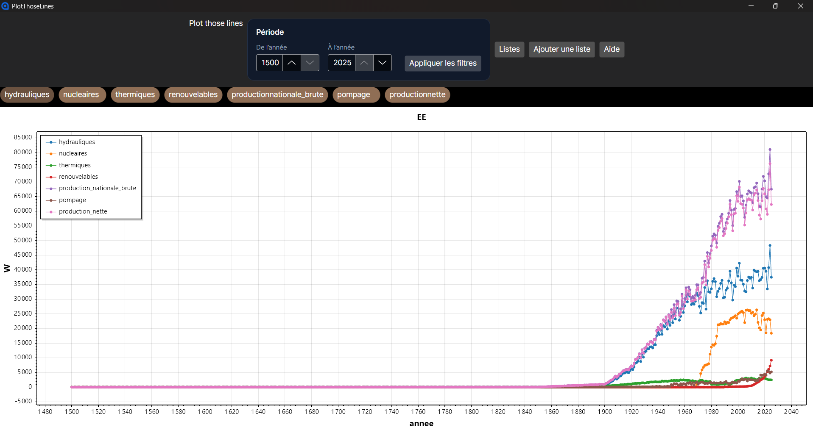
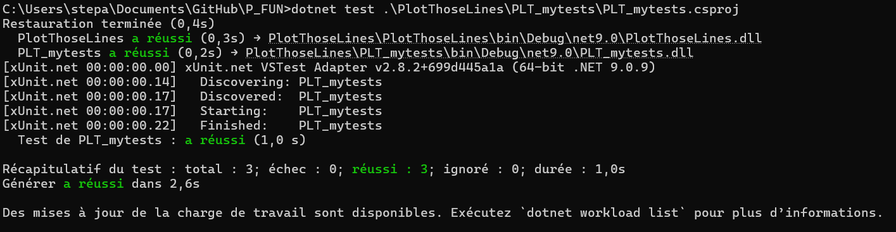

# Introduction

## Objectif

Une application de grapgique où on peut importer des fichier csv et afficher les courbes



## Description du domaine

Production en éléctricité en GWh en Suisse
Source: **Office fédéral de l'énergie, Statistique globale suisse de l'énergie** et script python pour atteindre 500 valeurs par séries

## Analyse fonctionnel

https://github.com/users/StepCode3630/projects/19

## Planification

https://github.com/users/StepCode3630/projects/19/views/4

# Tests

Les tests automatisés sont écrits avec xUnit dans le projet `PLT_mytests`. Ils vérifient actuellement :

- le formatage textuel d'un objet `Filter` ;
- la comparaison de deux années ;
- la validation d'une année valide.

La commande exécutée depuis le dossier _P_FUN_ est :

```powershell
dotnet test .\PlotThoseLines\PLT_mytests\PLT_mytests.csproj
```

**Résultat de la dernière exécution : 3 tests réussis, 0 échec.**


# Chapitre explicatif de l’usage fait de l’IA dans ce projet

Dans ce cade du projet, j'ai utilisé l'AI pour divers raisons:

- Quelle librairie graphique prendre, j'ai donc décider de prendre Avalonia.Net
- Documentation général d'Avalonia .net
- Kanban
- Comment marche Avalonia et quel fichier est le plus "important"
- De comment pouvoir importer un csv, je me suis aidé donc de l'extension **CSVHelper**
- De la logique de pouvoir importer un fichier csv
- Comment afficher un "pop-up" au démarrage du projet
- Comment utilisé les données que la fonction ImportCsv() m'ait donnée
- Comment marche l'Axaml, qui est assez différent mais reste sur le même principe qu'un xaml
- Comment utilisé une donnée Binding pour l'afficher sur l'application
- Comment utilisé une donnée que l'utilisateur ait renseigné dans un champ
- Comment insérer une autre page axaml en cliquant depuis un bouton
- Que MainViewModel sert de lien entre le axaml et cs
- COmment mettre en place les toogles et donc d'afficher ou non un courbe

En bref, je me suis aidé de l'IA pour mieux débugger, pour rechercher des informations précises, m'expliquer comment marche tel fonction et comment mettre en place tel chose. J'y ai aussi utilisé pour m'aider à créer le kanban et le rapport.

# Bilan du déroulement du projet

## Planning

Le projet a été organisé à l'aide d'un backlog et d'une roadmap afin de répartir les fonctionnalités et de suivre leur progression. La planification est consultable dans le [tableau de projet](https://github.com/users/StepCode3630/projects/19/views/4).

## Méthodologie

J’ai commencé par définir les fonctionnalités souhaitées à partir de mes idées et du cahier des charges, puis je les ai organisées dans le backlog. Avant le développement, j’ai conçu une maquette pour préciser l’interface. J’ai choisi Avalonia, une technologie dont le fonctionnement est proche de .NET MAUI, étudié à la fin de ma deuxième année. Le développement a ensuite été réalisé progressivement, avec Git pour suivre les versions du code et des autres éléments du projet, notamment le rapport et les fichiers de données.

## Problèmes rencontrés

Les principales difficultés ont été de comprendre comment un fichier `.axaml` est associé à son fichier `.cs`, comment utiliser les méthodes de plage telles que `Range()`, comment ouvrir et gérer d'autres vues depuis `MainWindow.axaml.cs`, et comment les valeurs sélectionnées dans l'interface sont transmises au code. L'importation et la préparation des données ont également demandé de prendre en compte le format des colonnes et la conversion des valeurs numériques. Enfin, tester une logique directement dépendante d'une fenêtre Avalonia est plus complexe qu'un test d'une fonction isolée. Ces difficultés ont été résolues progressivement grâce à l'AI, par la lecture de la documentation, des essais dans l'application, des échanges de code et l'ajout de tests lorsque cela était possible.

# Bilan du produit

| ce qu’on a                      | ce qu’on voulait            |
| ------------------------------- | --------------------------- |
| Importation de fichier csv      | Importation de fichier json |
| Afficher les séries             | Ajouter une valeur          |
| Afficher les infos du graphique | Supprimer une valeur        |
| Se déplacer dans le temps       | Exporter un fichier         |

# Conclusion

Ce projet m’a permis de développer une application de visualisation de données et de mettre en pratique C#, .NET, Avalonia, le traitement de fichiers CSV, les graphiques et un peu les tests unitaires. Il m’a également permis de mieux comprendre le lien entre une interface et son code, ainsi que l’importance de vérifier les données avant de les représenter.
